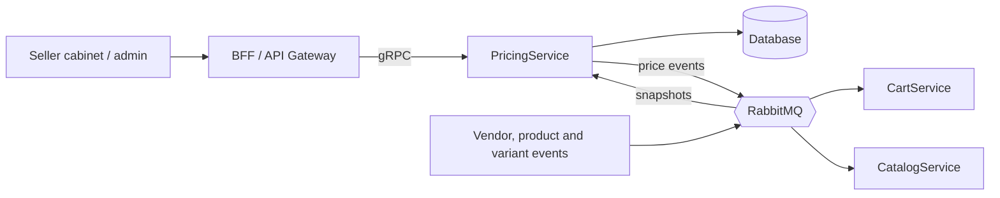
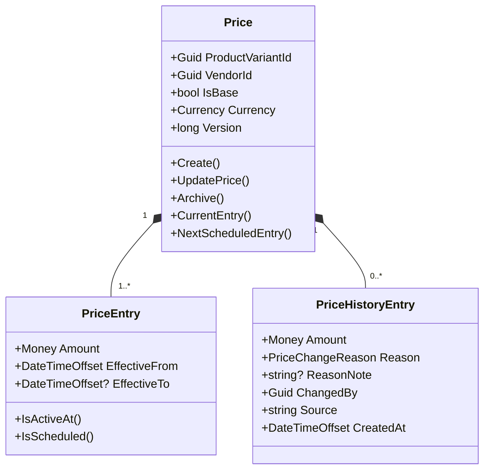
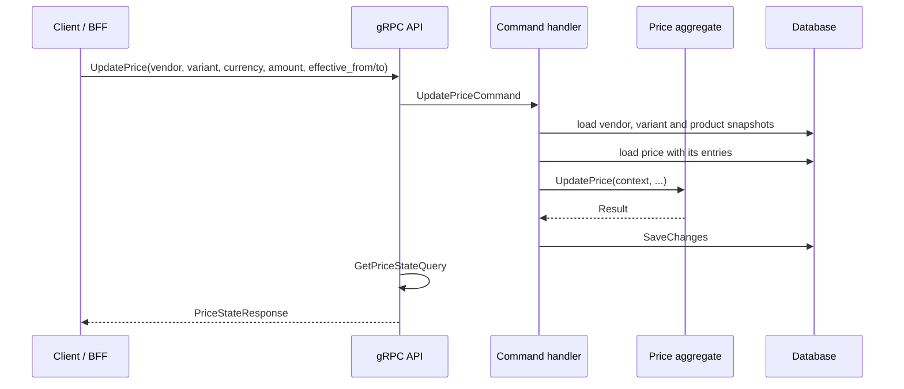

# PricingService

Pricing microservice of **MigApp**, an e-commerce marketplace platform built on microservices and CQRS.

PricingService owns one thing: the **price of a product variant**. For every `(variant, vendor, currency)` it keeps a gap-free timeline of price entries (the current price, scheduled prices and temporary prices) and an immutable history of every change. It stores prices exactly as the vendor set them. It does not convert currencies, apply discounts or decide whether a product is published.

## Contents

- [Responsibilities](#responsibilities)
- [Architecture](#architecture)
- [Tech stack](#tech-stack)
- [Solution layout](#solution-layout)
- [Domain model](#domain-model)
- [How it works](#how-it-works)
- [gRPC API](#grpc-api)
- [Currencies and markets](#currencies-and-markets)
- [Persistence](#persistence)
- [Observability](#observability)
- [Getting started](#getting-started)
- [Design decisions](#design-decisions)
- [Related services](#related-services)

## Responsibilities

| PricingService does | PricingService does not |
|---|---|
| Own the price of each variant, one price per `(variant, vendor, currency)` | Convert between currencies or compute prices shown to buyers |
| Keep a timeline of price entries: current, scheduled and temporary prices | Apply discounts or promotions (DiscountService does) |
| Guarantee that a live price always has an active entry | Decide whether a product is published (CatalogService does, using price events) |
| Record who changed a price, why and from which source | Own vendor, product or variant data |
| Validate changes against local vendor, product and variant snapshots | Reserve stock, hold carts or take payments |
| Publish price events for other services | |

## Architecture



PricingService follows Clean Architecture with CQRS:

- **Writes** go through the `Price` aggregate and EF Core.
- **Reads** are served by query handlers that use `AsNoTracking` queries and map the result to read DTOs.
- **Other services' data** (vendors, products, variants) arrives as integration events and is kept in local snapshots, so a price change never needs a call to another service.

## Tech stack

| Area | Technology |
|---|---|
| Runtime | .NET (see `global.json` / `TargetFramework`) |
| API | gRPC (`pricing.v1`) |
| CQRS | MediatR with pipeline behaviours |
| Persistence | EF Core (schema `PricesWrite`) |
| Messaging | MassTransit over RabbitMQ |
| Observability | OpenTelemetry (traces, metrics), Serilog (JSON logs) |
| Errors | `Result` pattern with error codes, no exceptions for business failures |
| Shared code | `migApp.Shared` (results, value objects such as `Money` and `Currency`, domain primitives, domain event dispatching) |

## Solution layout

```text
PricingService
├── PricingService.Domain           Aggregates, entities, specifications, domain events, errors
├── PricingService.Application      Commands, queries, integration event handlers, DTOs, mapping, interfaces
├── PricingService.Infrastructure   EF Core configurations, messaging, DI
└── PricingService.Api              gRPC services, proto files, mappers, Program.cs
```

Dependencies point inwards: `Api → Application → Domain`, and `Infrastructure → Application`.

## Domain model



**`Price`** is the aggregate root. It is identified by `(ProductVariantId, VendorId, Currency)`, and none of these change after creation. It owns the entries and the history, carries a `Version` for optimistic concurrency and raises a domain event for every change.

**`PriceEntry`** is one period during which an amount is in force: `EffectiveFrom` (inclusive) to `EffectiveTo` (exclusive, `null` means open-ended).

**`PriceHistoryEntry`** is an append-only record of a change: the new amount, the reason, an optional note, who made the change and from which source.

**Specifications and contexts.** Rules that depend on data from other services (vendor is active, product allows editing operational data) are checked by specifications. The command handler builds a small context object from the local snapshots and passes it to the aggregate, which evaluates the specification. The aggregate never reads snapshots itself.

### Business rules

- There is at most one price per `(variant, vendor, currency)`. A second `CreatePrice` for the same combination fails with `PriceErrors.AlreadyExists`.
- The currency of a price never changes. An update in another currency fails with `CurrencyMismatch`.
- `IsBase` is set once, at creation: a price is the **base price** when its currency equals the vendor's base currency. Prices in other currencies are explicit **market prices**.
- The initial price takes effect immediately.
- The entries form a **gap-free timeline** whose last entry is open-ended, so a live price always has an active entry.
- `Archive` is the only operation that intentionally leaves a price without an active entry.
- Every change appends a history record and increases the version.
- Domain methods receive the current time as a parameter and never call `DateTime.UtcNow`.

### The price timeline

An update either replaces the price from a moment on, or sets a **temporary** price. For a temporary price the aggregate adds a "tail" entry that restores the price that would have been in force, so the timeline never gets a hole.

```text
before          [ 100 ───────────────────────────────────────────→ ∞ )

update          80 from Dec 1 to Dec 8

after           [ 100 ── Dec 1 )[ 80 ── Dec 8 )[ 100 ─────────────→ ∞ )
                                                 └─ tail entry
```

| `UpdatePrice` call | Result |
|---|---|
| no `effective_from`, no `effective_to` | The new price is in force from now, open-ended. Scheduled entries from now on are replaced. |
| `effective_from` in the future | The new price is scheduled. The current price stays in force until then. |
| `effective_to` set | Temporary price. After it ends, the previously effective price resumes. |

An update is rejected when `effective_from` is in the past, when `effective_to` is not after `effective_from`, or when the price has no active entry and the update is scheduled or temporary (a price without an active entry can only be reactivated immediately and open-ended).

All validation happens before the aggregate is changed, so a failed update leaves it untouched.

## How it works

### Write path



Command handlers return only a `Result`. The API layer then runs a query, so every mutation answers with the fresh state of the price (current and next scheduled entry). The command and the query use the same database, so the query reads its own write.

Before the aggregate is called, the handler checks that the vendor, variant and product snapshots exist, that the product belongs to the vendor and that the currency is valid. A concurrent change of the same price fails on the version check.

### Read path

Queries load the price and map it to read DTOs. Nothing is converted: the `currency` in a request selects **which price** (which market) to read, and amounts come back in that currency.

| Query | Result |
|---|---|
| Price state | Current entry and next scheduled entry of the price in the given currency |
| Next scheduled price | The earliest entry that has not started yet, or `NoScheduledPrice` |
| Price history | Paged history of the price, newest first, optionally filtered by date |
| Variant prices | All prices of a variant for a vendor (one per market), the base price first, with the current amount of each |

A price that does not exist for the requested currency returns `PriceErrors.NotFound`.

### Domain events

Domain events are dispatched before and after the commit through `IDomainEventsDispatcher`. Integration events for other services are published to RabbitMQ with MassTransit.

| Event | Payload |
|---|---|
| `PriceCreated` | `PriceId`, `ProductVariantId`, `IsBase`, `Amount`, `Version` |
| `PriceUpdated` | `PriceId`, current `Amount`, `Version` |
| `PriceArchived` | `PriceId` |

Consumers identify a price by `PriceId`. `Amount` is a `Money` value and carries its currency.

### Integration events (inbound)

| Source | What changes in PricingService |
|---|---|
| Vendor events | Vendor snapshot: whether the vendor is active and its base currency |
| Product events | Product snapshot: owner vendor and whether operational data can be edited |
| Variant events | Variant snapshot: the product the variant belongs to |

## gRPC API

Contract: `Grpc/V1/Protos/pricing.proto`, package `pricing.v1`.

| RPC | Purpose |
|---|---|
| `CreatePrice` | Create the price of a variant in a currency, returns the price state |
| `UpdatePrice` | Change the price now, schedule it or set a temporary price, returns the price state |
| `GetPriceHistory` | Paged history of the price in a currency |
| `GetNextScheduledPrice` | The next scheduled entry of the price in a currency |
| `GetVariantPrices` | All prices of a variant for a vendor with their current amounts |

Requests carry `vendor_id` and `product_variant_id`. All RPCs except `GetVariantPrices` also carry the `currency_code` of the price they address.

Price state, returned by `CreatePrice` and `UpdatePrice`:

```text
PriceStateResponse
├── current          price_minor, currency_code, effective_from, effective_to
└── next_scheduled   same shape, empty when nothing is scheduled
```

All money values are integers in **minor units** of the price's currency (cents, grosze, and so on). An entry without `effective_to` is open-ended.

Business failures are returned as `Result` errors with stable error codes and translated into gRPC status codes. Clients should rely on the error code, not on the message.

## Currencies and markets

- A vendor has a **base currency**. The price in that currency is the **base price** (`IsBase = true`).
- A vendor can also set an **explicit price for another market** by creating a price in that currency. It is a separate `Price` with its own timeline, history and version.
- PricingService stores amounts exactly as entered and never converts them. Queries return the amount in the currency of the price they address.
- A price for a market that has no explicit price is not stored. Consumers derive it from the base price with an exchange rate when they need it. For example, CartService chooses the explicit price in the buyer's currency if there is one and otherwise converts the base price.
- Currency is fixed for the lifetime of a price. Changing a vendor's currency is a migration (archive old prices, create new ones), not an update.

## Persistence

Schema `PricesWrite`.

| Table | Notes |
|---|---|
| `Prices` | One row per `(ProductVariantId, VendorId, Currency)`, enforced by a unique constraint. `IsBase`, `Version` and a `RowVersion` concurrency token. |
| `PriceEntries` | Timeline entries of a price. `Amount` and `Currency` are stored from the `Money` value, `EffectiveFrom` and `EffectiveTo` define the period. Entries are removed when an update replaces them. |
| Price history | Append-only records, never changed or deleted by updates. |

Vendor, product and variant snapshots live in their own tables.

A unique-constraint violation on creation is translated into `PriceErrors.AlreadyExists` instead of surfacing a database exception.

## Observability

- **Traces and metrics:** OpenTelemetry (ASP.NET Core, HTTP client, MassTransit, runtime), exported over OTLP.
- **Logs:** Serilog, JSON to the console and OTLP, enriched with service name, machine name and thread id.
- **Health:** gRPC health checks for the database and RabbitMQ.

## Getting started

### Prerequisites

- .NET SDK (version from the repository's `global.json` or project files)
- The service database and RabbitMQ (use your local Compose setup)

### Configuration

Use user secrets or environment variables for anything sensitive.

```json
{
  "ConnectionStrings": {
    "Database": "<connection-string>",
    "OtlpEndpoint": "http://localhost:4317"
  },
  "RabbitMQ": {
    "Host": "localhost",
    "Port": 5672,
    "VirtualHost": "/",
    "Username": "<username>",
    "Password": "<password>"
  }
}
```

### Run

```bash
# apply migrations
dotnet ef database update \
  --project src/PricingService.Infrastructure \
  --startup-project src/PricingService.Api

# start the service
dotnet run --project src/PricingService.Api
```

Adjust the project paths to match the repository layout.

### Tests

```bash
dotnet test
```

## Design decisions

**One aggregate per `(variant, vendor, currency)`.** Each market has an independent timeline, history and version, so changes to different markets never conflict. The rules between markets (one base price per variant, one price per currency) are enforced by unique constraints and specifications, not by the aggregate.

**A gap-free timeline instead of "suspend when the price ends".** The aggregate guarantees that a live price always has an active entry. A temporary price restores the previous price with a tail entry. The only intended exception is `Archive`, and consumers react to `PriceArchived`.

**Currency is part of the price's identity.** It cannot be edited, so history and events never mix currencies inside one price.

**Queries do not convert.** The currency in a request selects the price. Converting is the job of the consumer that knows the buyer's currency and the exchange rate (CartService, for example).

**All validation before mutation.** `UpdatePrice` checks terms, currency and state first, then changes the aggregate, so a rejected update leaves no half-applied state.

**Commands return `Result`, the API layer returns the state.** The command side stays free of read concerns, while clients still get the fresh state of the price in one round trip.

**Events carry `PriceId`.** Consumers keep one record per price and update or remove it by id, whatever its currency.

**Time is a parameter.** Domain methods take `now` instead of reading the clock, which keeps them deterministic and testable.

## Related services

| Service | Relationship |
|---|---|
| CatalogService | Source of product and variant data. Uses price events to decide whether a variant can be published and kept available |
| Vendor / identity service | Source of the vendor snapshot (active flag, base currency) |
| CartService | Consumes price events into local price snapshots and resolves the price shown to the buyer |
| DiscountService | Applies discounts on top of the prices stored here |
| OrderService | Takes authoritative prices at checkout and records the price and currency used |
